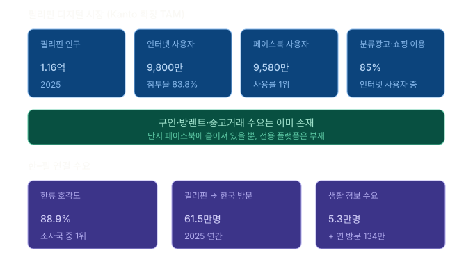

> 크롤러·스크래퍼 봇 트래픽 문제로 배포 주소를 **[https://kanto-pi.vercel.app](https://kanto-pi.vercel.app)** 로 이전했습니다.
> 11/12까지 점검 예정입니다.

# Kanto

> 필리핀 생활 필수 플랫폼 — 중고거래·구인구직·부동산을 한 곳에서

https://github.com/user-attachments/assets/bd780fbb-d23b-4103-87f6-92fc144d4d6b

## 🔗 링크

| 항목          | URL                                                                                       |
| ------------- | ----------------------------------------------------------------------------------------- |
| 라이브 데모   | [https://kanto-pi.vercel.app](https://kanto-pi.vercel.app)                            |
| 프로젝트 노션 | [Notion 기획 문서](https://app.notion.com/p/1-it-s-real-36e73873401a8099b037f045e2d2c9eb) |

> 테스트 계정 — ID: `test1234@naver.com` / PW: `test1234`

---

## 프로젝트 소개

Kanto는 필리핀어로 "우리 동네"라는 뜻입니다. 여러 채널에 흩어진 거래·일자리·주거 정보를 한곳에서 찾고 관리할 수 있는 신뢰도 높은 생활 플랫폼을 목표로 만들었습니다.



2025년 필리핀은 "세계 소셜 미디어 수도"로 꼽힐 만큼 디지털 이용 시간이 길지만, 생활 정보는 페이스북 그룹에 흩어져 있고 이 수요를 감당할 전용 플랫폼이 없습니다.

| 항목      | 내용                             |
| --------- | -------------------------------- |
| 개발 기간 | 2026.05.28 ~ 2026.07.07 (약 6주) |
| 팀 구성   | 박소유, 김도혁, 이동근, 임태형   |
| 배포 환경 | Vercel (main 브랜치 자동 배포)   |
| 대표 색상 | Teal — 필리핀의 바다에서 영감, 신뢰·성장·공동체를 상징 |

---

## 주요 기능

| 기능 | 설명 |
| --- | --- |
| 메인 피드 | 통합 검색, 히어로 배너, 카테고리별 인기 목록 |
| 중고거래 · 구인구직 · 부동산 | 카테고리·지역 필터, AI 이미지 검수, 마감일 D-N 배지, Google Maps 위치 검색 |
| 칸토고 (번개모임) | 지도에 모임 핀을 꽂고 참여, 실시간 그룹 채팅 |
| 채팅 · 안전결제 | 1:1 실시간 채팅, 채팅 안에서 Xendit 에스크로 결제 |
| 다국어 | 한국어 · 영어 · 필리핀어 전환 |
| 관리자 | KPI 대시보드, 사용자·게시글·신고·결제 관리 |

---

## 기술 스택

| 분류                | 기술 | 선택 이유 |
| ------------------- | ---- | --------- |
| 프레임워크          |   | Server Actions로 민감 로직을 서버에 격리, SSR로 초기 로딩 최적화 |
| 언어                |  | 4인 협업 시 타입 계약으로 인터페이스 오류 조기 차단 |
| 스타일링            |    | 디자인 시스템 없이 빠른 일관성 확보, shadcn은 접근성 기본 제공 |
| 상태관리            |   | Zustand는 인증·채팅 UI처럼 전역이지만 단순한 클라이언트 상태를 보일러플레이트 없이 관리, TanStack Query는 관리자 화면 서버 데이터 캐싱과 수정 후 목록 자동 갱신 |
| 국제화              |  | 서버·클라이언트 양쪽에서 동작, App Router 라우팅과 쿠키 기반 locale 유지에 최적 |
| 데이터베이스 / 인증 |  | RLS로 행 단위 접근 제어, Realtime으로 별도 소켓 서버 없이 1:1 채팅 구현 |
| 결제                |  | 필리핀 현지 결제 게이트웨이, 에스크로 인보이스 발행 지원 |
| 캐싱 / 레이트리밋   |  | Serverless 환경에서 연결 유지 비용 없이 슬라이딩 윈도우 방식 도배 방지 구현 |
| 문서 관리           |  | 약관 수정을 코드 배포 없이 Notion에서 직접 관리 |

---

## 시작하기

```bash
# 의존성 설치
npm install

# 개발 서버 실행
npm run dev

# 빌드
npm run build

# Supabase 타입 자동 생성
npm run gen:types
```

---

## 프로젝트 구조

```
src/
├── app/
│   ├── (user)/      # 사용자 화면 (메인, 중고거래, 구인구직, 부동산, 칸토고, 프로필 등)
│   ├── (admin)/     # 관리자 화면
│   └── api/         # Route Handlers (웹훅, AI, 인증, 약관 등)
├── components/      # 공통 · 칸토고 · shadcn/ui 컴포넌트
├── hooks/           # Realtime 채팅 · 모임 등 커스텀 훅
├── services/        # Supabase 쿼리 · 비즈니스 로직
├── store/           # Zustand 전역 상태
├── lib/             # 외부 클라이언트 초기화 (Supabase, Xendit 등)
├── utils/           # 포맷 · 이미지 최적화 등 유틸
├── type/            # 타입 정의 (Supabase 자동 생성 포함)
├── constants/       # 라우트 · 신고 유형 등 상수
└── i18n/            # next-intl 설정
messages/            # 번역 메시지 (ko · en · fil)
```

---

## 팀원

<table>
  <tr>
    <td align="center"></td>
    <td align="center"></td>
    <td align="center"></td>
    <td align="center"></td>
  </tr>
  <tr>
    <td align="center"><b>박소유</b> (팀장)<br><a href="https://github.com/soyupark1997">@soyupark1997</a></td>
    <td align="center"><b>김도혁</b><br><a href="https://github.com/DoHyuk-Centric">@DoHyuk-Centric</a></td>
    <td align="center"><b>이동근</b><br><a href="https://github.com/dongkeun99">@dongkeun99</a></td>
    <td align="center"><b>임태형</b><br><a href="https://github.com/THLIMM">@THLIMM</a></td>
  </tr>
  <tr>
    <td>결제 정산, 헤더·공통 컴포넌트, 상세 페이지, 보안·인프라</td>
    <td>실시간 채팅, 로그인 보안, 메인·검색, 디자인 시스템, SEO</td>
    <td>회원가입·본인인증, 다국어, DB 성능 최적화, 관리자 유저 관리</td>
    <td>소셜 로그인, 안전결제, 칸토고, AI 이미지 검수, 관리자 대시보드</td>
  </tr>
</table>
